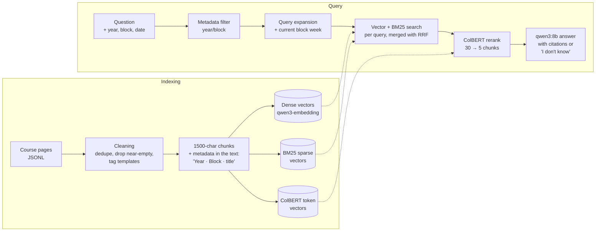

# Local RAG study assistant

A question-answering system over a university programme's course site: 506 login-protected pages covering three
study years. A student asks "is using an LLM allowed for the assignment?" or "what is due this week?" and gets a
short answer with numbered citations to the course pages, or "I don't know" when the pages don't say.

Everything runs on one desktop PC (8 GB GPU): the LLM, the embeddings, the vector database and the rerankers.
No question or course page leaves the machine.

The project is built evaluation-first: every retrieval change was measured on a fixed question set before it was
kept, and several ideas were dropped because the numbers said so. The full record is in
[evals/README.md](evals/README.md).

## Results

Development split. The starting point is plain vector search over the cleaned index; the default is the current
pipeline.

| | Page-style questions (28) | | Student-style questions (15) | |
|---|---|---|---|---|
| | start | **default** | start | **default** |
| Right page ranked first | 64% | **86%** | 33% | **47%** |
| Right page in the top 5 | 89% | **100%** | 47% | **67%** |
| All answer evidence in the LLM's context | 57% | **71%** | 20% | **27%** |
| Median time per answer | 3.5 s | **3.7 s** | 3.4 s | **3.6 s** |

Held-out test split, run once at the end of Phase 2. The starting point is the same configuration, taken from an
early run that covered every question:

| | Page-style questions (26) | | Student-style questions (13) | |
|---|---|---|---|---|
| | start | **default** | start | **default** |
| Right page ranked first | 77% | **77%** | 23% | **46%** |
| Right page in the top 5 | 96% | **96%** | 54% | **69%** |
| All answer evidence in the LLM's context | 65% | **73%** | 15% | **31%** |
| Median time per answer | 4.0 s | **4.1 s** | 2.9 s | **4.8 s** |

The test split is more modest than the development split. On page-style questions the page-level gain did not carry
over: the starting point was already high there, and the improvement is only in the chunks the LLM sees (+2
questions). Student-style questions improve on every retrieval measure, by 2-3 questions out of 13. The development
gain on page-style questions (+6 questions ranked first) was partly a result of choosing the configuration on that
same split, among many runs on 28 questions.

- **Page-style** questions are written from the pages and use their vocabulary. **Student-style** questions come from
  a real student and are short, vague and date-dependent ("vpn?", "whats due this week"). They are much harder.
- The best configuration measured (hybrid search + cross-encoder reranker) reaches 96% / 100% / 86% on page-style
  questions, but takes 9.5 s per answer on this hardware. The default gives up 3-4 page-style questions to answer in
  under 5 s.

## How it works



| Step | What it does | Why (measured on the dev split) |
|---|---|---|
| Metadata enrichment | Each chunk's metadata is written into its text before embedding ("Year 2 · Block B · page title", a contextual chunk header), so the vector also says where the chunk comes from | Each block has look-alike pages (deadlines, DataLab); right page first 59% → 63% |
| Metadata filtering | The same year/block metadata is stored next to each chunk in Qdrant; search is restricted to the year/block the question names, else the student's own, plus shared pages | Right page in top 5 87% → 93% |
| Corpus cleaning | Rules from a corpus-only EDA: merge exact duplicates, drop near-empty pages, keep templates out of search | No retrieval change; fewer junk chunks in the context |
| Query expansion (v2) | The LLM adds synonyms; code (not the LLM) adds the student's current week to time questions; all queries searched and merged | Within noise alone; with a reranker, student top 5 47% → 73% |
| Hybrid search | BM25 keyword search next to vector search, merged with reciprocal rank fusion | Alone: right page first 64% → 75%, all evidence 57% → 71%, for +0.3 s |
| ColBERT reranker | Late interaction: chunk token vectors computed at indexing time, question scored against them in Qdrant | Most of a cross-encoder's gain at 0.2 s instead of 6-7 s |

Rejected along the way, with the numbers in the log:
- **Letting the LLM rewrite the search query freely**: page-style top-5 hits fell from 93% to 61%. The 8B model copied
  words from its prompt examples into unrelated queries and dropped key terms.
- **Shortening the reranker's input** to make it faster: it missed answers further down the chunk and lost most of
  its gain.
- **More reranker candidates** (100 instead of 30): no gain; what vector search misses in its top 30 it also misses
  lower down. Keyword search fixed that recall gap instead.

In hindsight, hybrid search should have been the baseline before the reranker was added: it gets about a third of
the reranker's gain at almost no cost.

## Evaluation

- **Two question sets**: 62 page-style and 33 student-style questions, each with an expected answer, the pages that
  hold it, and short exact phrases from the answer. Unanswerable questions are included, and the expected answer is
  "I don't know".
- **Development / test split**: 50/50 per question type with a fixed seed. Failures are inspected on the development
  split only; the test split is run once, at the end of a phase, and reported as totals.
- **Retrieval metrics**: hit@k and MRR on pages, plus **chunk-level evidence**: whether the exact answer phrases are
  in the chunks the LLM actually saw. Page-level hit@5 was 93% while only 61% of questions had all their evidence in
  the context, so the page metric was hiding a chunk problem.
- **Answer metrics**: a local LLM judge grades correct / partial / wrong against the expected answer. A stronger model
  graded the same answers blind with a written rubric: 76% the same label (Cohen's kappa 0.57). Correctness numbers
  are treated as rough; retrieval numbers are exact.
- **Results per group**: every question is labelled with a question type (schedule, deadline, overview, rules, how-to,
  concept, people, out of scope) and a segment (the year/block its answer lives in, computed from the source pages), and
  development runs report each group separately. An average over everything hides where the system fails.
- **Noise floor**: one question is 3.6 points (page) or 6.7 points (student) on the development split. A difference is
  called real only when it spans several questions.
- **The eval was reviewed too**: a review found three bugs in the eval code (judge label parsing, partial refusals,
  and the app and eval merging result lists of different depth). Each got a failing test, a fix, and all 52 saved
  runs were re-graded from their saved answers.
- **CI**: 72 unit tests on every pull request. They need no LLM, database or course data: the models are faked.

## Known limitations

- **Date questions** ("do I have lectures tomorrow?", "when is the next lecture?") fail. The right schedule chunk is
  hard to retrieve, and an 8B model compares dates unreliably. Next step: a calendar route that reads the dated
  entries in code and lets the LLM only phrase the answer.
- **The week lookup** reads one page format; it currently works for 1 of 10 blocks. Generalising it is part of the
  next phase.
- **Small and lopsided evaluation sets** (28 and 15 answerable questions on development): differences of one or two
  questions are noise, and the questions cover mostly Year 2 Block B and the shared pages. 8 of the 14 parts of the site
  (blocks, semesters, year pages and shared pages) have no development question, and none asks for a person or contact.
- **The test split was partly seen**: some test questions were read in an early run, before the split was made.
- **Answer correctness is judged by LLMs** only; no human labels yet. The local judge also changes about 1 in 100
  labels when the same answer is graded twice.
- **Single-turn**: follow-up questions ("and when is it due?") are not rewritten with the earlier question.

## Roadmap

1. **Routing by question type** (schedule / rules / general search / refuse), with a calendar built from the block
   pages, and checks in code that dates, links and numbers in an answer appear in its sources.
2. **Evaluation per segment** (question type × year/block), so a gain for one kind of question can't hide a loss
   for another.
3. **Operations**: tracing, the eval as a CI gate on model and prompt changes, a load test (Ollama vs vLLM),
   streaming answers, and a container for the API.

## Running it

Requirements: Docker, [uv](https://docs.astral.sh/uv/), [Ollama](https://ollama.com) and an NVIDIA GPU with 8 GB
(the 4-bit `qwen3:8b` uses about 6 GB). The rerankers run on the CPU.

The course pages are not in the repository (they are behind a login). To use your own documents, put one JSON object
per line in `data/raw/adsai_pages.jsonl`:

```json
{"id": "Year2/BlockB/Deadlines", "text": "...", "source": "https://...", "metadata": {"title": "Deadlines", "section": "...", "year": "Year2", "block": "BlockB"}}
```

```
uv sync
ollama pull qwen3:8b && ollama pull qwen3-embedding:0.6b
docker compose up -d                       # Qdrant, dashboard at http://localhost:6333/dashboard

uv run python -m ragapp.ingest             # clean, chunk, embed, store
uv run python -m ragapp.bm25               # keyword index (2 s)
uv run python -m ragapp.colbert            # reranker index (about 5 min)

uv run python -m ragapp.rag "is using an llm allowed" --year Year2 --block BlockB
uv run uvicorn ragapp.api:app              # GET /ask?q=...&year=Year2&block=BlockB, docs at /docs
uv run pytest
```

Settings live in [src/ragapp/config.py](src/ragapp/config.py); the main ones can be overridden with environment variables:

| Variable | Default | Options |
|---|---|---|
| `HYBRID` | `1` | `0`: vector search only |
| `RERANK_KIND` | `colbert` | `cross`: cross-encoder (best quality, ~9.5 s per answer) |
| `RERANK_MODEL` | `BAAI/bge-reranker-base` | `""`: no reranking |
| `RERANK_INT8` | `0` | `1`: int8 cross-encoder, about 2× faster (`python -m ragapp.quantize` first) |
| `RERANK_CANDIDATES` | `30` | chunks the reranker re-sorts |
| `QUERY_REWRITE` | `2` | `0`: off |
| `CLEAN_CORPUS` | `1` | `0`: index the raw pages (re-ingest needed) |

## Stack

| Part | Choice |
|---|---|
| LLM | `qwen3:8b` (4-bit) via Ollama |
| Embeddings | `qwen3-embedding:0.6b`, 1024 dimensions, via Ollama |
| Vector database | Qdrant 1.20 in Docker: dense, sparse (BM25) and multi-vector (ColBERT) collections |
| Rerankers | fastembed (ONNX Runtime, CPU): `answerai-colbert-small-v1`, `bge-reranker-base` |
| API | FastAPI |
| Tooling | uv, pytest, GitHub Actions |

## Repository layout

```text
src/ragapp/
├── ingest.py, chunking.py, cleaning.py   # indexing: load, clean, chunk, embed, store
├── bm25.py, colbert.py                   # the two extra indexes
├── student.py, rewrite.py                # who is asking and when; query expansion
├── retrieve.py, rerank.py                # filter, hybrid search, RRF; rerankers
├── generate.py, rag.py, api.py           # answer prompt; the whole pipeline; HTTP API
└── config.py                             # every switch in one place
evals/                                    # eval runner, re-grader, judge rubric, result summaries
analysis/corpus_eda.py                    # corpus analysis that the cleaning rules come from
tests/                                    # unit tests (no LLM, database or course data needed)
```
